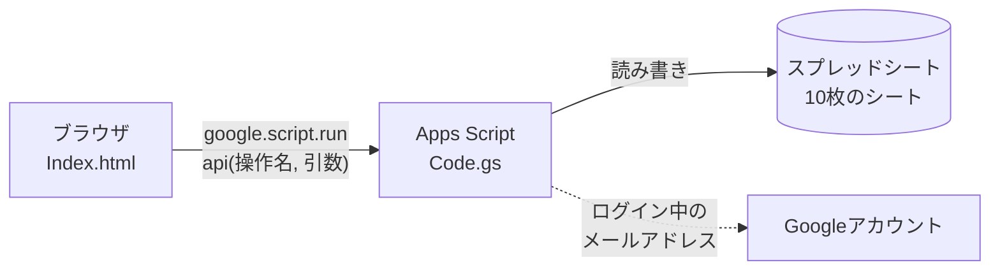
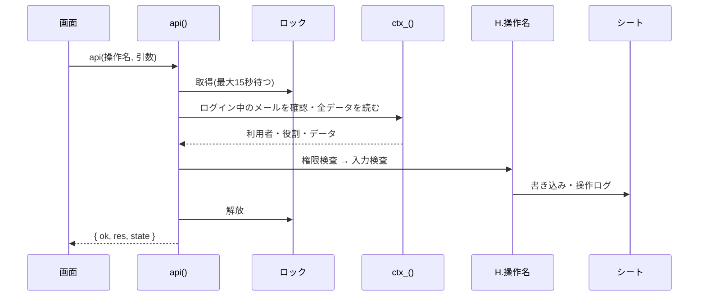

# 設計書 — 生徒会執行部タスク管理システム

| 項目 | 内容 |
|---|---|
| システム名 | 生徒会執行部タスク管理システム(student-council-task-manager) |
| 対象の版 | v1.6(2026-10-27) |
| 対象読者 | 導入する人、コードを読む・改造する人、セキュリティを確認する人 |
| 関連文書 | [README](../README.md)(導入と使い方)、[CHANGELOG](../CHANGELOG.md)(変更履歴) |

この文書は、現在のコードに合わせた仕様をまとめたものです。画面や操作の名前は、実際の画面に表示される言葉(「班」)を使います。「班」は、チームや部署と読み替えられます。

## 目次

1. 概要と設計方針
2. システム構成
3. 利用者と権限
4. データ設計
5. 画面設計
6. 操作(API)の仕様
7. 業務ルール
8. 入力チェック
9. セキュリティ設計
10. 同時実行と性能
11. 運用
12. テスト
13. 制限事項と今後

## 1. 概要と設計方針

### 目的

生徒会執行部(11〜30人を想定)が、各班の仕事の進み具合と期限を1か所で確認・更新できるようにします。

### 考え方

- **プロジェクト**: 各班が行う主要な仕事。
- **タスク**: プロジェクトを実現するために、短い期間に区切った達成項目。
- **班なしタスク**: どの班にも属さない単発のタスク。誰でも作成でき、「取り組む」を押した人が担当者になる。
- **資料**: タスクやプロジェクトなどに紐づくリンク集。

### 設計方針

| 方針 | 内容 |
|---|---|
| 追加費用をかけない | Googleスプレッドシートとアプリ開発基盤(Google Apps Script)だけで動かす。サーバーやデータベースを別に用意しない。 |
| 権限はサーバーで守る | 画面でボタンを隠すだけにせず、すべての操作をサーバー側で検査する。 |
| 壊れにくくする | 書き込む前にすべての入力を検査する。1つでも不正なら、何も書き込まない。 |
| 追跡できる | すべての更新を「操作ログ」に残す(個人の並び順を除く)。 |
| 小さく作る | 外部サービスに接続しない。ファイルは3つだけにする。 |
| 将来に備える | 重要フラグ・作成者・更新日時など、後から承認や通知を足すための列を最初から持つ。 |

## 2. システム構成



### 構成要素

| 要素 | ファイル | 役割 |
|---|---|---|
| 画面 | `Index.html` | 1ファイルの画面(HTML・CSS・JavaScript)。表示と入力だけを担当し、データを持たない。 |
| サーバー | `Code.gs` | 認証、権限検査、入力検査、シートの読み書き、操作ログ、セットアップ。 |
| マニフェスト | `appsscript.json` | ランタイム(V8)、タイムゾーン(Asia/Tokyo)、必要な権限、公開設定。 |
| データ | スプレッドシート | 導入者が作成した1冊のスプレッドシート。 |

### 公開設定

| 設定 | 値 | 意味 |
|---|---|---|
| 実行ユーザー(`executeAs`) | デプロイした本人(`USER_DEPLOYING`) | 利用者はスプレッドシートに直接アクセスする権限を持たなくてよい。 |
| アクセスできるユーザー(`access`) | ドメイン内の全員(`DOMAIN`) | 同じ組織のアカウントだけがURLを開ける。 |
| 権限(`oauthScopes`) | `spreadsheets.currentonly`、`userinfo.email` | 開いているスプレッドシートの読み書きと、ログイン中のメールアドレスの取得だけ。 |

### 処理の流れ



- 読み取り専用の `getState` は、ロックを取らずに最新の状態を返す。
- 書き込みの操作は、ロックを取った状態で「読み込み → 検査 → 書き込み」を行う。
- 成功した場合も失敗した場合も、応答は `{ ok: true, res, state }` または `{ ok: false, error }` の形になる。成功のたびに、最新の状態(`state`)を画面へ返す。

## 3. 利用者と権限

### 利用者の決まり方

- 利用できるのは、「メンバー」シートに登録され、`有効` が `FALSE` でない人だけ。
- 登録されていないアカウントは、画面を開いても「登録されていません」と表示され、データを見られない。
- メールアドレスは小文字にそろえて比べる。

### 役割

| 種類 | 役割 | 決まる場所 | 内容 |
|---|---|---|---|
| 全体の役割 | 会長 | 「全体権限」シート | 管理者と同じ。 |
| 全体の役割 | システム管理者 | 「全体権限」シート | 管理者と同じ。 |
| 全体の役割 | 先生 | 「全体権限」シート | 管理者と同じ(すべての権限)。 |
| 班ごとの役割 | 班長 | 「所属」シート | 自班の管理ができる。 |
| 班ごとの役割 | 班員 | 「所属」シート | 一般の利用者。 |

- 「管理者」は、会長・システム管理者・先生のいずれかを持つ人の総称。`G_ADMIN` で定義する。
- 廃止した役職(副会長)の行が「全体権限」シートに残っていても、無視する。
- 会長・システム管理者・先生のいずれも一人もいなくなる変更(役割を外す、メンバーを無効にする)は、拒否する。

### 権限表

| 操作 | 管理者 | 班長 | 班員 |
|---|---|---|---|
| 全班の閲覧(アーカイブ済みを含む) | ○ | ○ | ○ |
| タスク・プロジェクトの作成/編集(説明欄を含む) | ○(全班) | ○(全班) | ○(全班) |
| タスク・プロジェクトのアーカイブ/元に戻す | ○(全班) | ○(自班) | 不可 |
| ステータスの更新 | ○(全班) | ○(自班) | 自分が担当のみ |
| 班なしタスクの作成・編集、「取り組む」 | ○ | ○ | ○ |
| 班なしタスクの「取り組みをやめる」 | ○(誰の分でも) | 本人のみ | 本人のみ |
| 班なしタスクのアーカイブ/元に戻す | ○ | 作成者のみ | 作成者のみ |
| 資料の追加・削除 | ○ | ○ | ○ |
| タスクの並び替え(自分の表示) | ○ | ○ | ○ |
| 班員の追加・削除 | ○(全班) | ○(自班。班長の任命・解任は不可) | 不可 |
| 班の追加・名称変更・アーカイブ/元に戻す | ○ | 不可 | 不可 |
| メンバー登録、全体権限、班長の任命 | ○ | 不可 | 不可 |

### 権限の判定

| 判定 | 条件 |
|---|---|
| ステータスを更新できるか | 管理者、または自班の班長、または担当者。 |
| アーカイブ/元に戻せるか(班のあるタスク・プロジェクト) | 管理者、または自班の班長。 |
| アーカイブ/元に戻せるか(班なしタスク) | 管理者、またはそのタスクの作成者。 |
| 取り組みをやめられるか | 管理者、または担当者本人。 |

## 4. データ設計

### 保存の考え方

- すべてのデータを、1冊のスプレッドシートの10枚のシートに保存する。
- 1行目は見出し。`setup` が不足したシートと見出しを自動で作る。
- 日付・時刻は文字列で保存する(スプレッドシートの自動変換を防ぐため、書式を「書式なしテキスト」にする)。
- IDは、先頭に種類の文字(`t`=タスク、`p`=プロジェクト、`g`=班)と、ランダムな10桁の英数字を付けて作る。
- 操作のたびに全シートを読み直す。キャッシュは持たない。

### シート一覧

| シート | 内容 | 主な列 |
|---|---|---|
| メンバー | 利用者の登録 | メールアドレス、名前、有効 |
| 班 | 班の一覧 | 班ID、班名、アーカイブ |
| 所属 | 誰がどの班で何の役割か | メールアドレス、班ID、役割(班長/班員) |
| 全体権限 | 会長・システム管理者・先生 | メールアドレス、全体役割 |
| プロジェクト | プロジェクト | プロジェクトID、名前、説明・目的、担当班、開始日、終了日、状態、アーカイブ、作成者、作成日時、更新日時 |
| タスク | タスク | タスクID、タイトル、説明、担当班、プロジェクトID、開始日、期限、ステータス、優先度、重要フラグ、アーカイブ、作成者、作成日時、更新日時 |
| 担当者 | タスクと担当者の対応 | タスクID、メールアドレス |
| 資料リンク | 資料 | タスクID、資料名、URL、追加者、追加日時、区分、対象ID |
| タスク並び | 各ユーザーが並び替えた順番 | メールアドレス、一覧、タスクID、順番 |
| 操作ログ | 更新の記録 | 日時、操作者、操作内容、対象 |

### 関係

```mermaid
erDiagram
  members["メンバー"] ||--o{ affiliations["所属"] : "班の役割"
  teams["班"] ||--o{ affiliations : ""
  members ||--o{ globals["全体権限"] : ""
  teams ||--o{ projects["プロジェクト"] : "担当班"
  teams ||--o{ tasks["タスク"] : "担当班(空欄=班なし)"
  projects ||--o{ tasks : ""
  tasks ||--o{ assignees["担当者"] : ""
  members ||--o{ assignees : ""
  members ||--o{ orders["タスク並び"] : "本人の表示"
```

資料リンクは、`区分` と `対象ID` で、紐づけ先を決める(下の表)。

### 値の決まり

| 項目 | 値 |
|---|---|
| ステータス | `未着手` / `進行中` / `完了`(内部では `todo` / `doing` / `done`) |
| プロジェクトの状態 | `進行中` / `完了` / `保留` |
| 優先度 | `高` / `中` / `低` |
| 日付・時刻 | `yyyy-MM-dd`(時刻なし)または `yyyy-MM-dd HH:mm`(時刻あり)。日時の記録は `yyyy-MM-dd HH:mm:ss`。 |
| アーカイブ(タスク) | 空欄=通常、`task`=単独でアーカイブ、`project`=プロジェクトと一緒にアーカイブ |
| アーカイブ(プロジェクト・班) | 空欄=通常、`TRUE`=アーカイブ済み |
| 班なしタスク | 担当班が空欄。プロジェクトIDも空欄。 |

### 資料の区分

| 区分(`区分`) | 紐づけ先(`対象ID`) | 追加・削除できる人 |
|---|---|---|
| `all`(全体) | なし | 登録メンバー全員 |
| `team`(班全体) | 班ID | 登録メンバー全員 |
| `project`(プロジェクト) | プロジェクトID | 登録メンバー全員 |
| `task`(タスク) | タスクID | 登録メンバー全員 |

- 区分が空欄の古い行は、`task` として扱う。
- 同じURLは、同じ区分・同じ対象の中で重複して登録できない。

### 並び順(タスク並び)

- 並び替えた一覧ごと・ユーザーごとに、タスクIDと順番を保存する。
- 一覧名は、`team:<班ID>`、`free`(班なし)、`proj:<プロジェクトID>`、`mine`(自分のタスク)のいずれか。
- 保存のたびに、その人のその一覧の行をすべて消して、新しい順番を書き直す。

## 5. 画面設計

### 画面の構成

画面は、上部のタブで切り替える1つのページです。ページの再読み込みはしません。

| タブ | 内容 |
|---|---|
| ホーム | 班ごとのタスク件数、期限超過、進行中プロジェクトの進捗。「班なしタスク」のカード。表示の「自動 / ライト / ダーク」切り替え。 |
| 班別一覧 | 班ごとのタスク一覧。末尾に「班なし」タブ。タスク・プロジェクトの追加。アーカイブ済みのタスク。 |
| プロジェクト | 状態ごとのプロジェクト一覧。 |
| タイムライン | 期間を棒で表示。「全班 / 班ごと」で絞り込み。プロジェクトを選ぶと、そのタスク一覧と進捗。 |
| 自分のタスク | 自分が担当のタスク。アーカイブ済みのタスク。 |
| 資料 | 資料の追加・検索・削除。班 → プロジェクトの順に開閉して表示。 |
| 管理 | メンバー・班・役割の管理、班員の編成、アーカイブの確認と元に戻す。 |

上部の右側に、ログイン中のユーザー名と「会議モード」(文字を大きくする)を置きます。

### 主な部品

| 部品 | 内容 |
|---|---|
| タスク詳細 | タスクをクリックすると開く。ステータスの変更、資料の追加・削除、編集、アーカイブ、取り組む/やめる。 |
| 追加・編集フォーム | タイトル・担当班・説明・プロジェクト・担当者・開始日・期限・優先度・資料。開始日と期限は「時刻なし / 時刻を指定」を選べる。 |
| アーカイブ済みのタスク | 開閉式の一覧。詳細は読み取り専用で、資料の追加・削除と、権限のある人の「元に戻す」だけができる。 |
| ドラッグ並び替え | タスク一覧の行をドラッグして並び替える(PCのブラウザ)。 |
| 実行中表示 | 保存や削除の間、画面全体を覆って「実行中…」を表示し、二重押しを防ぐ。 |

### 画面の振る舞い

- 画面は、サーバーから受け取った `state` だけを元に描き直す。データを画面側で書き換えない(並び替えだけは、保存前に画面で先に反映する)。
- 操作中に別の操作を押すと、「処理中です」と表示して受け付けない。
- 削除・アーカイブなどの取り消しにくい操作は、ボタンを2回押して確定する。
- 文字は、画面に出す前にすべてエスケープする(`esc`)。
- ライト/ダークの選択は、このブラウザに記憶する(保存できない場合も、動作は続ける)。
- アーカイブ済みの班は、ホーム・班別一覧・プロジェクト・タイムラインに出さない。

## 6. 操作(API)の仕様

画面からの操作は、すべて `api(操作名, 引数)` を通ります。操作名は、`H` に登録した関数に対応します。

| 操作 | できる人 | 内容 |
|---|---|---|
| `getState` | 登録メンバー | 最新の状態を返す(ロックなし)。 |
| `saveTask` | 登録メンバー | タスクの作成・編集。`free` を指定すると班なしタスク。作成時に資料を一緒に登録できる。 |
| `setTaskStatus` | 担当者・自班の班長・管理者 | ステータスの更新。 |
| `takeTask` | 登録メンバー | 班なしタスクに取り組む(担当者になる)。 |
| `leaveTask` | 担当者本人・管理者 | 取り組みをやめる(ステータスは「未着手」に戻る)。 |
| `saveProject` | 登録メンバー | プロジェクトの作成・編集。作成時に資料を一緒に登録できる。 |
| `archive` | 班長(自班)・管理者(班なしタスクは作成者も) | タスク・プロジェクトのアーカイブ。 |
| `restore` | 同上 | アーカイブから元に戻す。 |
| `addDoc` | 登録メンバー | 資料の追加。 |
| `deleteDoc` | 登録メンバー | 資料の削除。 |
| `saveOrder` | 登録メンバー | 自分の並び順の保存(操作ログには残さない)。 |
| `addMember` | 管理者 | メンバーの登録。 |
| `setActive` | 管理者 | メンバーの有効/無効。 |
| `setGlobal` | 管理者 | 会長・システム管理者・先生の任命・解任。 |
| `setTeamRole` | 管理者、班長(自班の班員のみ) | 班の役割(なし/班員/班長)の変更。 |
| `addTeam` / `renameTeam` | 管理者 | 班の追加・名称変更。 |
| `archiveTeam` / `restoreTeam` | 管理者 | 班のアーカイブ・元に戻す。 |

管理用の関数として、`setup`(シートの作成・最初の管理者の登録)と `seedDummy`(テスト用のダミーデータ)があります。どちらも、エディタから実行します。

## 7. 業務ルール

### タスク

- 登録メンバー全員が、アーカイブされていない班に、タスクを作成・編集できる。
- 担当者は、そのタスクの班に所属する有効なメンバーから選ぶ(複数可)。
- 編集で、班のあるタスクを班なしに、または班なしタスクを班のあるタスクに変えることはできない。
- ステータスを更新できるのは、担当者・自班の班長・管理者。

### 班なしタスク

- 登録メンバー全員が作成・編集できる。プロジェクトには入れられない。作成時に担当者は選べない。
- **取り組む**: 担当者がいないときだけ押せる。押した人が担当者になる。担当者は1人だけで、同時に押された場合も、先に処理された1人だけが担当者になる(ロックの中で判定するため)。完了したタスクには取り組めない。
- **取り組みをやめる**: 担当者本人と管理者ができる。やめると、ステータスは「未着手」に戻り、再び募集中になる。完了したタスクでは、やめられない。
- 取り組みは、「担当者」シートと操作ログに残る。将来、取り組んだ人にポイントを付ける仕組みを足すための土台だが、ポイントに関する機能・列は、まだ実装していない。

### プロジェクト

- 登録メンバー全員が、アーカイブされていない班に、作成・編集できる。
- 進捗は、プロジェクトに属する(アーカイブされていない)タスクのうち、完了した割合で表示する。
- タスクの期間が、プロジェクトの期間からはみ出していると、警告を表示する(保存はできる)。

### アーカイブ

| 対象 | 動作 |
|---|---|
| タスク | アーカイブ済みにする(`task`)。通常の一覧から消え、「アーカイブ済みのタスク」に移る。全員が見られる。 |
| プロジェクト | アーカイブ済みにし、属するタスクを一緒にアーカイブする(`project`)。元に戻すと、`project` のタスクだけが一緒に戻る。 |
| 班 | アーカイブした班は、各画面から消える。その班のタスク・プロジェクトの作成・編集・状態更新はできない。資料の追加・削除はできる。 |

- アーカイブ済みのタスクは、状態の変更・編集・取り組むができない。資料の追加・削除はできる。
- アーカイブ済みのプロジェクトの下のタスクを、単独で元に戻すことはできない(先にプロジェクトを戻す)。
- アーカイブ済みのタスクの資料は、資料ページの「アーカイブ済みのタスクの資料」と検索に表示される。

### 日付と時刻

- 開始日と期限は、それぞれ「時刻なし」または「時刻を指定」を選べる。
- 比べるときは、時刻のない開始は `00:00`、時刻のない終了・期限は `23:59` として扱う。
- 開始が終了(期限)より後になる保存は、拒否する。
- 「期限超過」は、現在時刻が期限を過ぎ、完了していないタスク。「まもなく」は、期限まで3日以内のタスク。

### 資料

- 区分は、全体・班全体・プロジェクト・タスク。登録メンバー全員が、どの区分でも追加・削除できる。
- 作成時には、資料を最大10件まで一緒に登録できる。1件でも不正なら、何も作成しない。
- 検索は、資料名・URL・追加者・班名・プロジェクト名・タスク名を対象に、空白で区切った語をすべて含む資料を探す。

### 並び替え

- 各ページのタスク一覧で、行をドラッグして並び替えられる。
- 順番は一覧ごと・ユーザーごとに保存され、本人の画面だけに反映される。
- 並び替えていないタスクは、期限の順で下に並ぶ。

### 操作ログ

- 更新のたびに、日時・操作者・操作内容・対象を「操作ログ」に追記する。
- 資料つきの作成は、作成と資料の登録で2行になる。
- 並び替えは、個人の表示設定なので、記録しない。

## 8. 入力チェック

書き込みの前に、すべての入力を検査します。1つでも不正なら、何も書き込みません。

| 項目 | 決まり |
|---|---|
| タイトル・プロジェクト名 | 必須、100文字以内 |
| 説明・説明/目的 | 1000文字以内 |
| 資料名 | 必須、100文字以内 |
| 資料のURL | 必須、2000文字以内、`http` または `https` で始まる |
| 班の名前 | 必須、30文字以内 |
| メンバーの名前 | 必須、50文字以内 |
| メールアドレス | 必須、200文字以内、形式を検査 |
| 日付 | `yyyy-MM-dd`(任意で ` HH:mm`)。実在しない日付・時刻は拒否 |
| 優先度・状態・ステータス | 決まった値だけ |
| 担当者 | その班に所属する有効なメンバー |
| 並び替えの一覧名 | `team:<ID>`、`free`、`mine`、`proj:<ID>` のいずれか。タスクIDは500件まで |

## 9. セキュリティ設計

### 前提

- ウェブアプリは、同じ組織のアカウントだけが開ける設定(`DOMAIN`)で公開する。
- 利用者の本人確認は、Googleのログインに任せる(`Session.getActiveUser()`)。
- データは、導入者のスプレッドシートにだけ保存する。外部のサーバーには送らない(外部への通信処理を含まない)。

### 対策

| 脅威 | 対策 |
|---|---|
| 登録されていない人が使う | メンバーとして登録・有効な人だけを通す。それ以外には、画面もデータも返さない。 |
| 権限のない操作をする | すべての操作を、サーバー側で権限検査する。画面の表示は、権限の根拠にしない。 |
| 不正な入力 | 書き込み前にすべて検査する。型・長さ・形式・存在を確認する。 |
| 画面への文字の埋め込み(XSS) | 画面に出す文字をすべてエスケープする。URLは `http(s)` だけを許す。 |
| 同時操作によるデータの食い違い | 書き込みの操作は、スクリプト全体のロックの中で行う。 |
| 管理者がいなくなる | 最後の管理者を外す変更・無効にする変更を拒否する。 |
| 不正な並び替えの対象 | 一覧名とタスクIDの形式を検査する。他人の並び順は、読み書きできない。 |
| 権限の迂回 | シートの直接編集は権限検査を通らないため、シートの共有を管理者だけに限る運用にする。 |
| 取り消しにくい操作の誤操作 | 削除・アーカイブは、ボタンを2回押して確定する。 |
| なりすまし(テスト用機能) | 「代行表示」は、`DEV_MODE=1` を設定したときだけ有効で、管理者だけが使える。本番では設定しない。 |

### 残るリスクと運用での対応

- スプレッドシートを直接編集できる人は、権限の検査を通さずにデータを変えられる。共有範囲を管理者だけに限る。
- 「操作ログ」シートは、編集できる人が書き換えられる。改ざんの検知が必要な場合は、共有範囲の制限と、シートの版の履歴で確認する。
- デプロイした人のアカウントの名義で動くため、そのアカウントの管理を、複数の管理者で共有する。

## 10. 同時実行と性能

- 書き込みの操作は、`LockService` のスクリプトロックを最大15秒待って取得する。待っても取れないときは、エラーになる。
- 操作のたびに、全シートを読み直す(1操作ごとに最新の状態を使うため)。
- 想定は、メンバー11〜30人、タスク・資料が数百件までの規模。データが増えて遅くなったときは、古いアーカイブを別のシートや別のスプレッドシートに移す。
- 並び順の保存は、1回につき、その人のその一覧の行を消して書き直す(最大500件)。

## 11. 運用

### 導入と更新

詳しい手順は、[README](../README.md) の「セットアップ」「更新を反映する手順」にあります。要点は次のとおりです。

1. 必ず、新規作成したテスト用のスプレッドシートで動作確認する。
2. `Code.gs` と `Index.html` は、必ず両方をそろえて入れ替える。
3. コードを入れ替えたら、新しいバージョンでデプロイし直す(保存だけでは、公開中のURLに反映されない)。
4. シートや列が増えた版では、`setup` を実行する(実行しても、既存のデータは消えない)。

### 引き継ぎ

- デプロイしたアカウントが使えなくなると、システムが止まる。スクリプトの編集権限を、管理者2〜3人で共有する。
- 役員の交代では、「メンバー」の無効化と「所属」「全体権限」の変更を、管理画面から行う。

### バックアップ

- スプレッドシートの「版の履歴」と、定期的なコピーを残す。
- 年度の区切りには、コピーを残したうえで、アーカイブの整理を検討する。

## 12. テスト

### 自動テスト(`test/run.js`)

Apps Script の環境(シート・ロック・ユーザー・日付)を模擬して、`Code.gs` を直接動かします。`node test/run.js` で実行し、現在131件の確認が通ります。

| 分類 | 内容 |
|---|---|
| 権限 | 役割ごとの許可と拒否(管理者・先生・班長・班員・未登録)、他班への操作、最後の管理者の保護 |
| 入力 | 日付・時刻の形式と前後、URL、重複、不正な値 |
| タスク・プロジェクト | 作成・編集、ステータス、アーカイブと元に戻す(連動を含む) |
| 班なしタスク | 作成、取り組む(1人だけ)、やめる、完了後の制限、アーカイブ |
| 資料 | 4区分、作成時の同時登録(1件でも不正なら何も作らない)、アーカイブ済みのタスクへの追加・削除 |
| 班 | アーカイブと元に戻す、アーカイブ後の資料の追加 |
| 並び替え | 保存・上書き・解除、ユーザーごとの分離、不正な一覧名 |
| 記録 | 操作ログの件数が、成功した更新の数と一致すること、日付が文字列で保存されること |

### 画面の確認

画面(`Index.html`)は、ブラウザ(Chromium)で、サーバーを模擬した応答を使って確認しています。確認した内容は、表示、ドラッグ並び替え、アーカイブ済みのタスクの表示と詳細、資料の検索、実行中表示です。

### 未確認の項目

実際の Apps Script と組織のアカウントでの動作は、導入時に確認してください。特に、「ドメイン内の全員」への公開、スマートフォンでの表示、タッチ操作、データが増えたときの速度は、確認していません。

## 13. 制限事項と今後

### 制限事項

- メール通知、カレンダーとの連携は、ありません。
- 承認の流れ(完了報告・2段階承認・差し戻し・期限変更の申請)は、ありません。
- ポイント機能は、ありません(班なしタスクの取り組みの記録だけを残している)。
- タスクのドラッグ並び替えは、タッチ操作に対応していない。
- 操作は1つずつ順に処理されるため、同時に操作が多いと、少し待つことがある。
- 班を外したメンバーが担当しているタスクの担当者は、自動では外れない(タスクを編集して直す)。

### 今後の候補

| 候補 | 内容 |
|---|---|
| ポイント | 取り組んだ人にポイントを付ける。付与の条件・点数・集計・表示を決めたうえで、列と画面を足す。 |
| 通知 | 期限の前や担当になったときに、メールで知らせる。 |
| カレンダー連携 | 期限や行事を、共有カレンダーと連携する。 |
| 承認の流れ | 班員の提案、完了報告、2段階承認、差し戻し、期限変更の申請。 |
| 「重要」の指定 | 重要フラグ(列は用意済み)を画面で扱う。 |
| タッチ操作での並び替え | ボタンやタッチに対応した並び替え。 |
| 速度の改善 | 読み込みを減らす、古いアーカイブを別の場所へ移す。 |

### 変更履歴

版ごとの変更は、[CHANGELOG](../CHANGELOG.md) を参照してください。

### ライセンス

[MIT License](../LICENSE)
